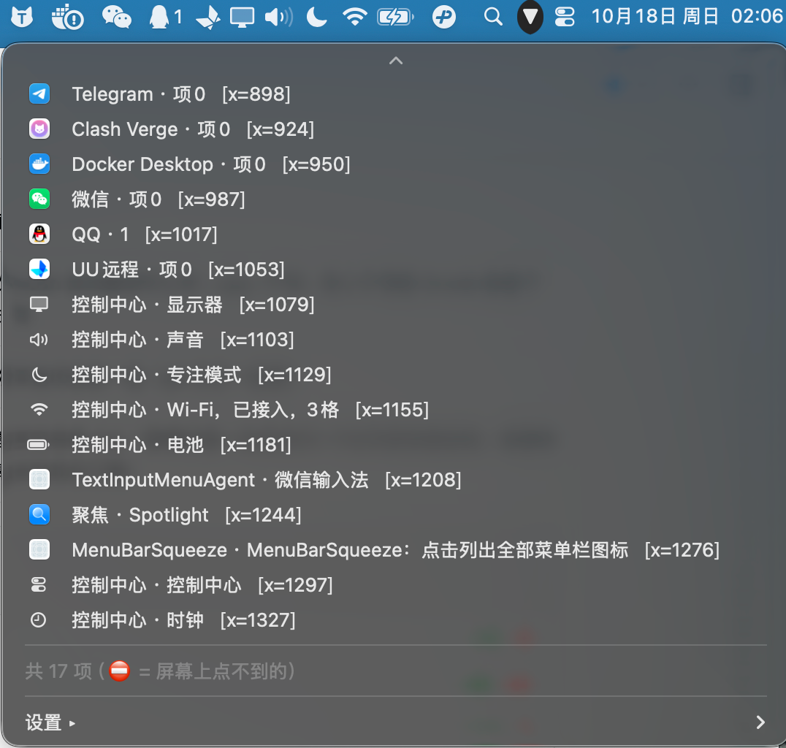

# MenuBarSqueeze

**English** | [中文](README.zh-CN.md)

A tiny **native macOS menu bar utility** (Swift + AppKit, zero dependencies) that fixes the notched-MacBook problem:

> Menu bar icons that don't fit — or get hidden under the notch — are still **reachable**.



<p align="center">
  <em>▾ triangle in the menu bar → a dropdown listing all status items with icons → click one to open its menu.</em>
</p>

## Why this exists

On MacBooks with a notch, the usable menu bar area is only the part **right of the notch**. When it fills up:

- newly added status items are placed **under the notch** and never drawn,
- you can't see them, and you can't click them.

Hiding other icons does **not** help — it doesn't create space. The only real fix is a **secondary UI** that can list and trigger those items. That's what this app does.

## Features

### 1. All menu bar items list (primary, needs Accessibility permission)

- Left-click the ▾ icon → a dropdown listing **every menu bar item of every running app**, each with an icon
- Items that macOS never laid out are marked `⛔` (still listed, still clickable)
- Click an entry → **its menu opens**, exactly as if you clicked the real icon
- Hold **⌥ (Option)** while clicking → **activates the owning app** instead
- Smart activation:
  1. try `AXPress` (fast, doesn't move your mouse)
  2. if no menu appears within ~0.35 s, synthesize a real mouse click at the item's coordinates
  3. remember that app in a list, so next time it goes straight to the synthesized click

### 2. Optional "squeeze" / collapse (off by default, no permissions needed)

Enable it from the right-click menu and a `↔` divider appears:

```
[hidden icons…]  [↔ divider]  [▾ triangle]  [always-visible icons…]  [system icons]
                      ↑ inflates                        ↑ click to toggle
```

Collapsing sets the divider's `NSStatusItem.length` to `min(screenWidth × 2, 10000)`, pushing everything to its left off-screen. Same public technique as [Hidden Bar](https://github.com/dwarvesf/hidden) (MIT).

## Requirements

- macOS 13 or later (Apple Silicon or Intel)
- **Accessibility permission** for the "all items" feature (System Settings › Privacy & Security › Accessibility)
- Xcode or Command Line Tools (`swiftc`) to build

## Build & install

### Install a prebuilt release

Download **`MenuBarSqueeze-x.y.z.dmg`** from [Releases](../../releases), open it, drag the app into **Applications**.
The app is not notarized, so on first launch: right-click → **Open**, or

```bash
xattr -dr com.apple.quarantine /Applications/MenuBarSqueeze.app
```

A `.zip` is published alongside the DMG (handy for Homebrew casks and scripts).

### Build from source

```bash
./build.sh            # build into ./build/MenuBarSqueeze.app
./build.sh install    # build + copy to /Applications + launch
FORCE_ADHOC=1 ./build.sh   # sign ad-hoc (used by CI/releases)
```

Signing behaviour: if an **Apple Development** certificate exists in your keychain, it is used — this keeps the Accessibility grant valid across rebuilds. Otherwise the app is signed ad-hoc, and **you must re-grant Accessibility after every rebuild**.

## Usage

| Icon | Left click | Right click |
|---|---|---|
| **▾ triangle** | list all menu bar items | settings menu |
| **↔ divider** (only if enabled) | collapse / expand | settings menu |

### Settings menu

| Item | Meaning |
|---|---|
| Enable "squeeze" | creates the `↔` divider (collapse feature) |
| Idle auto-collapse | only shown when squeeze is enabled |
| Expand on hover | only shown when squeeze is enabled |
| Launch at login | writes a user LaunchAgent (no admin password) |
| Rescan / request Accessibility permission | re-enumerates and re-prompts |
| Quit | — |

## Configuration

Defaults live in the `local.menubarsqueeze` domain:

```bash
defaults write local.menubarsqueeze showSeparator       -bool false   # 收起功能（默认关）
defaults write local.menubarsqueeze autoCollapse        -bool false   # 闲置自动收起
defaults write local.menubarsqueeze hoverExpand         -bool false   # 悬停自动展开
defaults write local.menubarsqueeze syntheticClickBundleIDs -array com.example.app  # 强制合成点击的 App
```

Icon position is controlled by the standard autosave keys (smaller = further right):

```
"NSStatusItem Preferred Position MenuBarSqueeze.toggle" = 10;
```

## Diagnostics

| File | Content |
|---|---|
| `/tmp/menubarsqueeze-ax.txt` | Accessibility trust state + enumerated menu bar items (`x=…`) |
| `/tmp/menubarsqueeze-action.log` | every click: which path was taken (AXPress / synthesized click) and result |
| `/tmp/menubarsqueeze-diag.txt` | status item frames (used while developing) |

## Project layout

```
main.swift       # the whole app (single file, ~600 lines)
Info.plist       # LSUIElement bundle (menu bar only, no Dock icon)
build.sh         # swiftc build + .app packaging + signing
README.md        # this file
README.zh-CN.md  # Chinese docs
```

## Limitations

- **macOS 27+**: the classic length trick may stop working (macOS moved to a native visibility mechanism); the *all items* feature is unaffected.
- Items macOS never laid out (`x=0`, shown as `⛔`) can be listed, but a synthesized click may not reach them — use ⌥-click to open the app instead.
- No private APIs are used, therefore no "second row of real icons" rendering (that's what Bartender does with private APIs + Screen Recording).

## Uninstall

```bash
pkill -f MenuBarSqueeze
rm -rf /Applications/MenuBarSqueeze.app
launchctl bootout gui/$(id -u)/local.menubarsqueeze 2>/dev/null
rm -f ~/Library/LaunchAgents/local.menubarsqueeze.plist
defaults delete local.menubarsqueeze 2>/dev/null
```

## License

[MIT](LICENSE)
